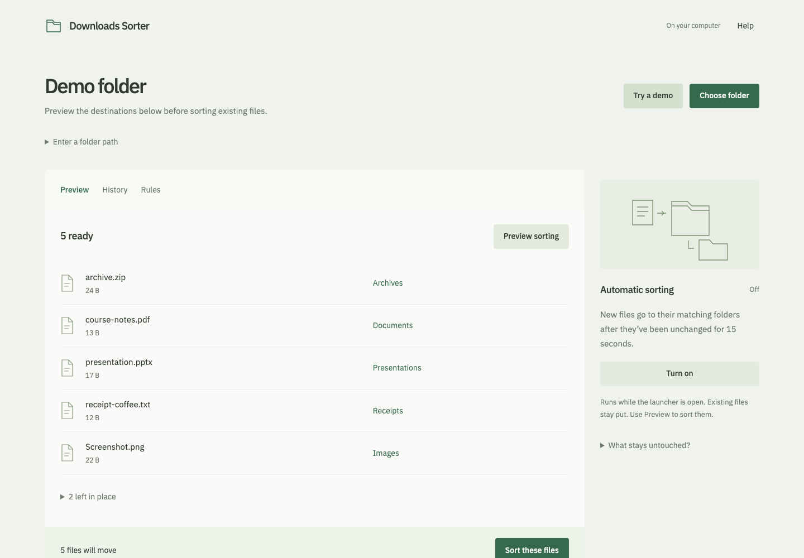

# Downloads Sorter

A small app that files your downloads into folders. Preview the changes, sort them, or turn on automatic sorting for new files. Undo is available in the run history.

[**Download the app ZIP**](https://github.com/rishitpradhan-gif/downloads-sorter/releases/latest/download/downloads-sorter.zip) · [Latest release](https://github.com/rishitpradhan-gif/downloads-sorter/releases/latest)



## Send this to a friend

1. Install [Node.js 22 or later](https://nodejs.org/en/download) if it is not already installed.
2. Download the ZIP above and extract it.
3. On **Mac**, open `Open Downloads Sorter.command`. On **Windows**, open `Start Downloads Sorter.bat`. On **Linux**, run `sh start.sh`.
4. Choose **Try a demo** first. Then choose your own folder, select **Preview sorting**, and review the destinations before selecting **Sort these files**.

There is no account, API key, package installation or cloud service. The interface opens in your browser at a loopback address on your own computer. These launchers are scripts, not signed native installers. Core/API and browser workflows were executed on macOS; Windows/Linux launcher and native folder-dialog behavior remain untested.

**Leave the launcher window running for automation.** Closing the browser tab alone does not stop the server. Close the launcher or press Ctrl+C there to stop. Automatic mode starts off each time you launch the app.

## What it does

The default rules create Receipts, Images, Documents, Spreadsheets, Presentations, Archives, Video and Audio folders as needed. Edit the rules in the app. Rules run top to bottom; a matching filename word **or** file extension selects the destination.

- Previewing reads filenames and hashes eligible files without moving them.
- Sorting moves only the reviewed files whose contents and metadata still match the preview.
- Duplicate names receive a numbered suffix. Existing files are never intentionally overwritten.
- Automatic mode snapshots existing names when enabled, then checks for new files every 15 seconds. A file must be unchanged for at least 15 seconds. Edited pre-existing files stay put. If a name disappears and is later observed again, it can be treated as new. A replacement between scans under the same existing name may be missed conservatively.
- Undo checks fingerprints and restores original names when available. A modified sorted file or occupied original filename is left untouched, with the reason shown in History.
- Folders, shortcuts/symlinks, hidden files, partial downloads, files above 2 GiB and unmatched extensions stay in place. Only the selected folder's top-level files are considered.

There is no AI inference or external network request in normal use. This is rule-based automation. No startup/login service is installed.

## Where its records live

Settings are stored in `.local-data` beside the app. Each organized folder gets a hidden `.downloads-sorter` folder containing run records and SHA-256 fingerprints. Keep that folder if you want to undo. File contents are not stored in those records. Local paths and filenames are included, so review them before sharing any history. The downloadable release excludes runtime data.

The tool uses same-filesystem hard links followed by removal of the old filename, preserving the file's bytes and metadata. This requires a filesystem that supports hard links; unsupported operations fail without intentionally removing the source. Network/cloud-managed folders and unusual filesystems have not been validated. Close applications writing to the folder and keep backups of important work. This is a convenience tool for a trusted local folder, not a transaction or security boundary against concurrent malicious filesystem changes.

Empty destination folders remain after undo. A power loss can leave a pending journal; use its Undo action to recover when possible. If a crash leaves `.downloads-sorter/active.lock`, first close **all** sorter instances and confirm no operation is running, then remove only that lock file before reopening. Do not remove the run JSON files.

## Use it as a JavaScript module

```sh
npm install github:rishitpradhan-gif/downloads-sorter
```

```js
import {scanFolder, applyPlan, undoRun} from '@rishitpradhan/downloads-sorter';

const plan = await scanFolder('/absolute/path/to/Downloads');
console.log(plan.moves); // No files have moved.

// After reviewing the plan:
const run = await applyPlan(plan);
console.log(run.moves);

// To restore unchanged files when their original names are free:
await undoRun(plan.root, run.id);
```

The module uses only Node built-ins. No runtime packages are required. The `applyPlan` call is explicit authorization to move the listed files. Treat preview JSON as sensitive local data, and inspect any plan received from elsewhere before applying it.

You can also use the CLI:

```sh
node cli.mjs preview /absolute/path/to/Downloads --out preview.json
# Review preview.json before continuing:
node cli.mjs apply preview.json
node cli.mjs history /absolute/path/to/Downloads
node cli.mjs undo /absolute/path/to/Downloads RUN_ID
```

## Develop and test

```sh
npm ci
npm test
node server.mjs
# In another terminal, with a compatible Playwright Chromium installed:
SORTER_BROWSER=/path/to/chromium npm run test:browser
npm run package
```

The standard suite uses temporary synthetic files. The browser suite uses generated demo files only. It never needs your real Downloads folder. See [validation](docs/validation.md) and [executed browser results](docs/browser-results.json).

The local API binds to `127.0.0.1`, validates Host and Origin headers and requires a per-session token from the app page. It is intended for one trusted local user. It is not an authenticated network service and must not be exposed through a public tunnel.

MIT license. IBM Plex Sans is bundled with its license. Built by Rishit Pradhan.
